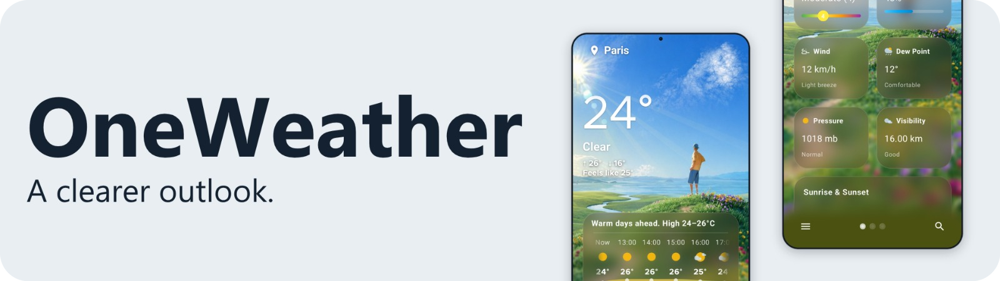
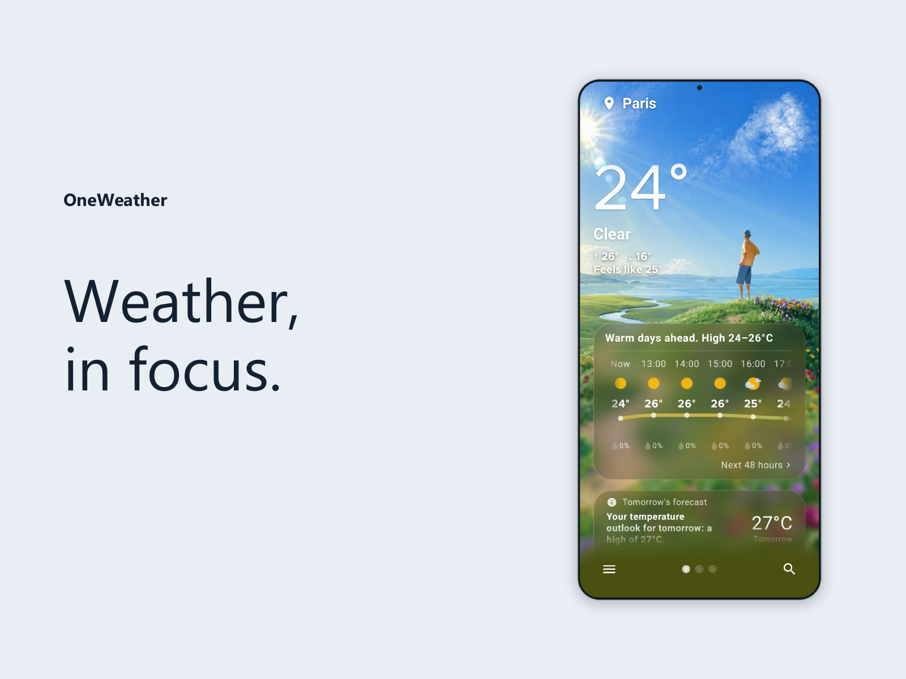
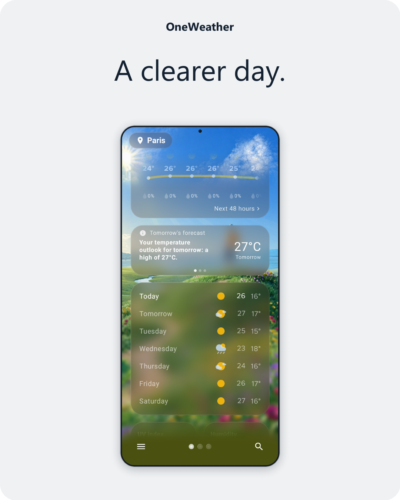
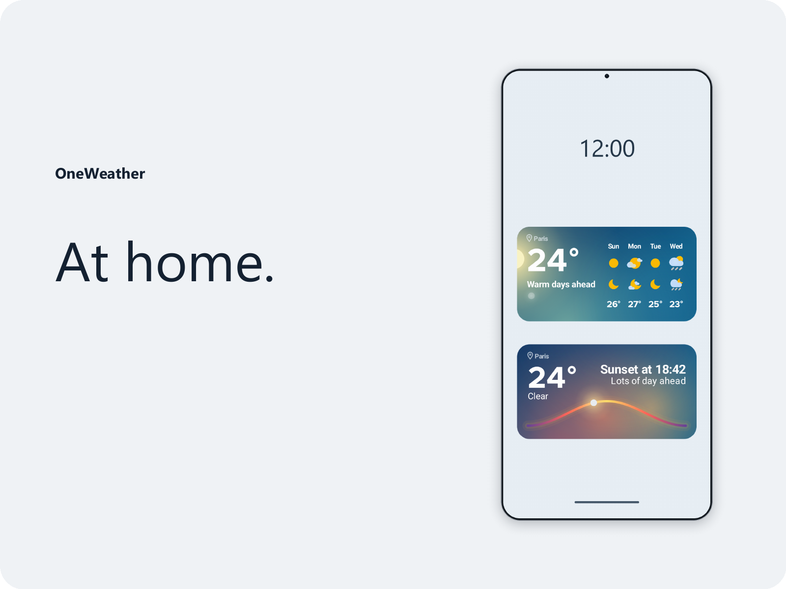

 

**A One UI-style weather app for Android.**

  
  
  

 

<table>
  <tr>
    <td width="38%" align="center" valign="top">
      
       The background follows the weather and the time of day. Soft forecast cards sit on top without hiding it.
    </td>
    <td width="23%" align="center" valign="top">
      
       The next 48 hours, then the week day by day. Most elements expand in place.
    </td>
    <td width="38%" align="center" valign="top">
      
       Widgets take on the colors of the weather. Choose a shiny border or a One UI style blurred look.
    </td>
  </tr>
</table>

 

---

### Download

**v1.0** is coming soon.

  

1. Open [Releases](https://github.com/MoonGuyyy/OneWeather/releases)
2. Download the latest `.apk`
3. Open it on your Android phone and install

You may need to allow installs from your browser or file manager the first time.

### Credits

Big thanks to [@Galvestz](https://x.com/Galvestz). OneWeather's design, widgets included, is inspired by their concept, and the icons are theirs. Go follow them on [X](https://x.com/Galvestz).

### Feedback

Ideas, bugs or just a hello: find me on [X](https://x.com/MoonGuyyy_).
